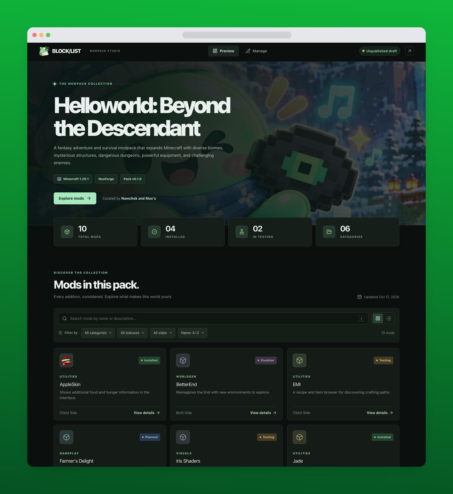

# MC Mod Manager

[](https://github.com/namchokGithub/mc-mod-manager/actions/workflows/deploy.yml)
[](https://react.dev/)

[](LICENSE)

A static Minecraft modpack showcase with a local, in-browser editor. The public **Preview** page shows the pack and its mods; the **Manage** page lets you edit them, check compatibility, and save the result straight to the project's JSON files. Manage is available only when running locally with `pnpm dev`; the GitHub Pages site shows Preview only. There is no backend: the published site is static, and the only file writing is done by the local dev server.



> The sample data is for demonstration. Always check each mod's upstream page before installing.

## Features

- **Preview**: hero, pack stats, searchable and filterable mod grid or list, and a detail dialog with compatibility notes.
- **Manage** (local only): add, edit, duplicate, and delete mods; edit pack settings; per-row status, compatibility, and update badges.
- **Large lists**: pagination (20, 50, or 100 per page), multi-select across pages, and bulk delete with confirmation.
- **Save to local JSON**: writes `public/data/*.json` through the dev server, with validation and a conflict check.
- **JSON import and export** for `modpack.json` and `mods.json`, validated before anything changes.
- **Local drafts** saved automatically in this browser's LocalStorage, kept in sync across open tabs, with warnings before unsaved form edits are lost.
- **Modrinth search**: find a mod, filter its versions by game version and loader, review a compatibility preview, then add it through the normal form.
- **Compatibility checker** (read-only): Minecraft version, modloader, required and incompatible dependencies, duplicate projects, and missing metadata. Results are Compatible, Warning, Incompatible, or Unknown.
- **Update checker**: compares each linked mod with the versions Modrinth lists for the pack. Results are Up to date, Update available, or Unknown.
- **JAR import**: reads `.jar` files or a mods folder locally, with an import preview and duplicate warnings.
- **Light and dark themes**: light by default, with a toggle in the header. The choice is remembered in this browser.
- **Toasts, confirmations, and reduced motion**: clear feedback for every change, confirmation before destructive actions, and animations that respect `prefers-reduced-motion`.

## Tech stack

React 19, TypeScript (strict), Vite, Tailwind CSS 4 with a custom stylesheet built on CSS variables, Radix Dialog, Select, and Popover with cmdk for searchable dropdowns, React Hook Form with Zod, Motion for React, lucide-react icons, and Vitest. No backend, database, or authentication; a small Vite dev-server plugin handles local saving.

Code layout:

- `src/app`: app shell, routing, data provider, toasts, and theme.
- `src/features`: the `preview`, `manage`, `modrinth` (search and version picker), and `import` (JAR) screens.
- `src/components`: shared UI such as dialogs, buttons, badges, and mod artwork.
- `src/lib`: logic without UI. This covers schemas (`schema.ts`), drafts and export (`storage.ts`), local saving (`localSave.ts`), filtering and pagination, compatibility, updates, the Modrinth client (`modrinth/api.ts`, `mapping.ts`, `service.ts`, `versionFilters.ts`), and JAR parsing (`jar/`).
- `vite-plugins`: Node code for the dev server, currently the local JSON save endpoint.
- `src/styles.css`: all styling. Colors come from theme tokens on `:root` (light) and `:root[data-theme="dark"]`.

## Requirements

- Node.js 24 or newer
- pnpm 11.24.0 (`corepack enable` picks up the version in `package.json`)

## Local development

```sh
pnpm install --frozen-lockfile
pnpm dev
```

Open the Vite URL for Preview, or add `#/manage` for the editor. Manage and drafts exist only in development (`import.meta.env.DEV`). Production builds, including `pnpm preview`, show Preview only, redirect `#/manage` and other unknown routes to Preview, and always display the published JSON.

| Command          | What it does                                   |
| ---------------- | ---------------------------------------------- |
| `pnpm dev`       | Start the dev server                           |
| `pnpm lint`      | Run ESLint                                     |
| `pnpm typecheck` | Run the TypeScript project build in check mode |
| `pnpm test`      | Run the Vitest unit tests                      |
| `pnpm build`     | Type-check and build to `dist/`                |
| `pnpm preview`   | Serve the production build locally             |

## Data

Published data lives in two files:

- `public/data/modpack.json`: one object with `name`, `description`, `version`, `minecraftVersion`, `modloader`, `modloaderVersion`, `author`, `updatedAt` (`YYYY-MM-DD`), and `heroImageUrl`.
- `public/data/mods.json`: an array of mods. Each mod has `id` (unique), `name`, `version`, `category`, `tags`, `status` (`planned`, `testing`, `installed`, `disabled`, `removed`), `side` (`client`, `server`, `both`), `source` (`Modrinth`, `CurseForge`, `GitHub`, `Other`), `sourceUrl`, `description`, `dependencies`, `notes`, and `imageUrl`.

Optional fields added by later features. Files without them still load:

- `modrinth`: the linked project and selected version: `projectId`, `slug`, `versionId`, `versionNumber`, `versionType`, `datePublished`, `gameVersions`, `loaders`, `dependencies` (each with `projectId`, `versionId`, `type`, `name`), and `syncedAt`.
- `file`: the local `.jar` an entry came from: `name`, `sha1`, and `modId`.

`heroImageUrl` accepts an `http` or `https` URL, or a path under `public/assets/`, such as `public/assets/theme/winter_slime_adventure_in_the_snow.png`. Repository paths are resolved under the Vite base path. Commit the image along with the JSON. Leave it empty to use the built-in illustrated hero.

The schemas are in `src/lib/schema.ts`.

## Drafts, import, and export

**Editing in the browser never changes the published site.** The workflow is:

1. Run `pnpm dev` and edit in **Manage**. Changes are saved as a draft in this browser's LocalStorage about half a second after each change. Preview in the same browser shows the draft.
2. When ready, click **Save to local JSON** at the top of Manage and confirm. The dev server writes `public/data/modpack.json` and `public/data/mods.json` directly, and the draft is cleared. Exporting from **Manage → Data & export** and replacing the files by hand still works as a backup.
3. Commit and push the JSON files. The site updates after the GitHub Pages workflow finishes.

Saving to local JSON:

- It exists only while `pnpm dev` runs (a Vite dev-server plugin). Production builds and GitHub Pages have no write endpoint.
- It accepts requests only from this computer, from the app's own localhost page. It writes only those two files, after validating them with the same schemas as import, and writes atomically (temporary file, then rename).
- If the files changed on disk since the page loaded (for example, edited in an editor or by `git pull`), it shows a conflict and only overwrites after you confirm.
- It never runs automatically. Edits keep autosaving to the browser draft until you click Save.

Details:

- A draft belongs to one browser and one device. Clearing site data removes it. Other visitors always see the published files.
- **Reset draft** (with confirmation) discards the draft and returns to the published data.
- **Import** validates the file first. An invalid file changes nothing and shows why. A valid file asks for confirmation before it replaces the current mods or settings.
- If a stored draft can no longer be read, the app shows the published data, keeps the old draft under the LocalStorage key `mc-mod-manager:draft:v1:unreadable`, and tells you.
- A draft that matches the published data exactly is cleared on load, so the "Unpublished draft" badge disappears after you publish.
- The theme choice is stored separately under `mc-mod-manager:theme` and is never part of exported data.
- With several tabs open, a tab follows drafts saved or reset in another tab instead of overwriting them.
- Closing the mod editor, leaving unsaved pack settings, or reloading the page with unsaved form edits asks for confirmation first.

## Modrinth integration

The app calls the public Modrinth API (`https://api.modrinth.com/v2`) directly from the browser. No key or account is needed.

- **Search Modrinth** (Manage) searches mods, optionally filtered by the pack's Minecraft version and loader. Search results are not treated as compatible. The version you pick is checked against its own metadata before you add it.
- The version step has **Game version** (searchable) and **Modloader** filters that start from Pack settings, plus **Show all versions**. Each project's full version list is fetched once and filtered locally. A version that does not match Pack settings is flagged.
- **Update from Modrinth** (↻ on a row) links or changes the version. Only the version and the `modrinth` snapshot are replaced; your name, notes, status, side, and other edited fields are kept. Empty fields are filled.
- **Check compatibility** fetches current metadata for linked versions. **Check updates** fetches each project's compatible version list once, caches it for five minutes, and limits itself to four requests at a time.
- Updates are judged by version IDs, release channel, and publish date, never by comparing version strings. Ties, missing dates, and unclear ordering show as Unknown.
- Nothing is ever downloaded or installed, and the checkers never change your mods.

## Importing JAR files

**Manage → Import mods** accepts `.jar` files (multi-select or drag and drop) or a whole folder in Chromium-based browsers.

- Files are read only in your browser. They are never executed or uploaded. Only small metadata files inside each archive are read.
- Supported metadata: `fabric.mod.json`, `quilt.mod.json`, `META-INF/mods.toml`, and `META-INF/neoforge.mods.toml`. `${file.jarVersion}` is resolved from `META-INF/MANIFEST.MF`.
- Without metadata, the file name is used as an unverified hint.
- The preview flags duplicates (same file, same Modrinth project, same mod ID, or same name) and lets you choose what to import.
- **Match files** is optional. It sends only SHA-1 hashes to Modrinth to identify exact versions and attach verified metadata.

## Deploying to GitHub Pages

The site is served from `https://<username>.github.io/mc-mod-manager/`. It is read-only: there is no Manage page, and LocalStorage drafts are ignored.

1. Push this repository to GitHub as `mc-mod-manager`. If you use another name, change the `base` in `vite.config.ts` to match.
2. In the repository, open **Settings → Pages** and set **Build and deployment → Source** to **GitHub Actions**.
3. Push to `main`, or run **Deploy to GitHub Pages** from the **Actions** tab.

The workflow (`.github/workflows/deploy.yml`) installs with `pnpm install --frozen-lockfile`, runs lint and typecheck, builds with `GITHUB_PAGES=true` so assets use the `/mc-mod-manager/` base path, and publishes `dist`. Navigation uses hash routes (`#/`, `#/manage`), so no rewrite rules or `404.html` are needed. The app needs no secrets.

To try the production paths locally:

```sh
GITHUB_PAGES=true pnpm build
pnpm preview
```

Then open `http://localhost:4173/mc-mod-manager/`.

## Known limitations

- Drafts are per browser. There is no sync, account, or multi-user editing, and only one modpack profile.
- Publishing still needs a commit and push. **Save to local JSON** only works while `pnpm dev` runs and does not include edits still open in a form.
- Each JSON file is replaced atomically, but the pair is not: if renaming the second file fails, the first is already updated.
- Compatibility needs Modrinth version metadata. Manual and unmatched entries are always Unknown.
- Loaders must match exactly, except Fabric mods on Quilt, which are a Warning. Forge-only versions on a NeoForge pack are reported as Incompatible. That is correct for current Minecraft versions; only NeoForge 1.20.1 packs could load many Forge mods.
- Declared Minecraft version ranges in JAR metadata are shown but not evaluated.
- Modrinth does not expose its rate-limit headers to browsers, so a rate-limit message cannot say exactly how long to wait.
- Search shows up to 100 results per query.
- JAR import reads up to 500 files per batch. It does not support ZIP64 archives, cannot tell Forge from NeoForge 1.20.1 when `mods.toml` has no loader dependency, and does not use mod icons from inside the JAR.
- Folder selection is not available in Firefox or Safari; selecting multiple files works everywhere.
- Update and live compatibility results are not saved. They reset when the page reloads.
- If two tabs edit within about half a second of each other, the later saved draft wins.
- CurseForge, automatic downloads, and dependency installation are not supported.

---

© _2026 Namchok Singhachai_. MC Mod Manager is released under the [MIT License](LICENSE).
